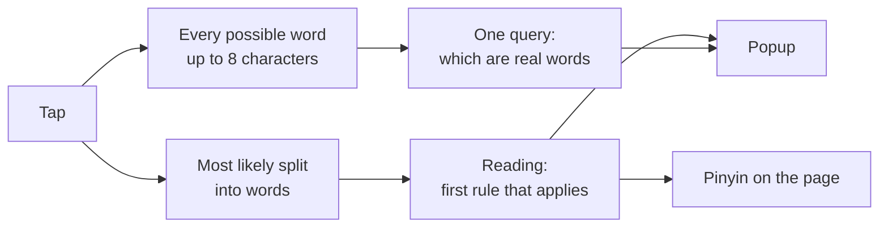

# koreader-chinese-helper

**Read real Chinese books on your e-reader. Tap any character to see the words it forms in this
sentence, the reading it has here, and what it is made of. Show pinyin above only the rare
characters, or above every one, and take it away one reading at a time as you learn.**

A [KOReader](https://github.com/koreader/koreader) plugin for e-ink readers. Chinese has no
spaces between words, so an ordinary dictionary lookup means long-pressing, dragging a selection
and guessing where the word ends. Here you tap once. The plugin reads the text on both sides of
the character, finds the dictionary words actually written there, and marks the reading the
character takes in this sentence: 行 is *háng* in 银行 but *xíng* in 行人 (see
[Readings](#readings)).

- **Starting out?** Turn on pinyin above **every character on the page**
  ([Learner mode](#learner-mode)) and read a real novel from the start. Tap a character whose
  reading you know, mark it known, and that reading loses its pinyin everywhere, in every book,
  so the pinyin thins out as your reading grows.
- **Reading confidently?** Keep pinyin only for the rarest characters, at the level you choose.
  Chengyu come with their classical sources, a [文言 mode](#classical-mode) adds the senses
  classical texts use, and Taiwan's MOE dictionary can be read in Chinese by
  [tapping its text](#tapping-a-character-in-the-popup).

Useful from your first Chinese book to your hundredth. It works on any reflowable book (EPUB,
FB2, MOBI, TXT and the like) as soon as you open it: nothing to prepare, and the book file is
never modified.

KOReader 中文阅读插件：点一个字，即可看到它在本句中组成的词及其释义，并标出它在此处的读音；还可在字上方显示拼音，从只标生僻字到每个字都标（学习模式），学会一个读音点一下即可隐去，初学者和熟练读者都适用。

![The opening of 三国演义 第一回 on a Boox Go 7: the chapter title, then the popup on 密. At its top, the line 时有宦官曹节等弄权，窦武、陈蕃谋诛之，作事不密，反为所害，中涓自此愈横。 with 密 in bold and underlined; the title bar, 密 on the left and the buttons 文言 Mode and Remind me: mì on the right; first the word around it, labelled Wikt: 不密 bùmì "(literary) not well thought out; (literary) not secret"; then 字频 646 in small grey and, on the row below, the label CEDICT; 密 mì, "dense; close; … (bound form) secret; confidential …", "Mì: surname Mi"; its parts, labelled Wikt: 宓 mì still; silent → sound (same sound), 山 shān mountain → meaning; buttons 密 and 不密, then Translate & analyze the surrounding sentence [AI] on its own row, then Close at the bottom. Below the popup, the end of the paragraph's last line, 密，反为所害，中涓自此愈横。, with 密 underlined on the page](docs/main.png)

It has only been tested on a Boox Go 7, but it should work on any e-reader that runs KOReader:
Kobo, Kindle, PocketBook, and Android devices such as Boox.

<table>
<tr>
<td width="50%"><br><a href="#learner-mode"><b>From beginner to advanced</b></a>: pinyin on every character in learner mode …</td>
<td width="50%"><br>… switched off one reading at a time as you learn them: the same paragraph with the 80 commonest readings on the page <a href="#learner-mode">marked known</a></td>
</tr>
<tr>
<td><br><a href="#usage"><b>Pinyin only above the hard characters</b></a>, at the level you choose (here the default: outside the 3,500 most common)</td>
<td><br><a href="#the-popup"><b>The reading it has here</b></a>, and the word that decides it: 间 is <i>jiàn</i> in 间或</td>
</tr>
<tr>
<td><br><a href="#character-components"><b>What each character is made of</b></a>: 茴 is 艹 for the meaning and 回 <i>huí</i> for the sound</td>
<td><br><a href="#character-components"><b>Parts the simplification hid</b></a>: 观 is read through 觀, 雚 <i>guàn</i> → sound</td>
</tr>
<tr>
<td><br><a href="#chengyu"><b>Chengyu explained</b></a>: 之乎者也 with Xinhua's line (optional file) …</td>
<td><br>… and its <a href="#chengyu"><b>Origin &amp; Usage</b></a> view: the classical source and an example from this same passage of 孔乙己</td>
</tr>
<tr>
<td><br><a href="#classical-mode"><b>Classical mode</b></a>: one tap on 文言 Mode puts the senses classical texts use first, here 之 as <i>him; her; them</i> in 窦武、陈蕃谋诛之</td>
<td><br><a href="#tapping-a-character-in-the-popup"><b>Read the dictionary by tapping</b></a>: 歡, tapped in MOE's quotation of 〈琵琶行〉, opens its own popup in place of the first, titled 秋 › 歡</td>
</tr>
<tr>
<td><br><a href="#fallback-dictionaries"><b>Several dictionaries, each labelled</b></a>: CC-CEDICT for 秋, Wiktionary for 秋月, and MOE (optional) for 秋月春风, in larger type</td>
<td><br><a href="#translating-the-sentence"><b>Translate &amp; Analyze the sentence</b></a> with KOAssistant: a translation and a plain-English, word-by-word breakdown of 孔乙己's 窃书不能算偷, down to why he says 窃 and not 偷 (your own AI provider, while Wi-Fi is on)</td>
</tr>
</table>

<details>
<summary>About these screenshots</summary>

All screenshots were taken on a Boox Go 7 in landscape, with the [sample book](#the-sample-book),
default settings and every [optional dictionary](#optional-dictionaries) installed. The two
learner-mode shots use All characters, and the second has 80 readings marked known.
`tools/make_screenshots.py` retakes them all except KOAssistant's response, which has to be taken
on its own because the AI's answer changes from run to run.

</details>

### Features

- **One tap, no selecting**: tap anywhere in the text (on a character, between lines, on
  punctuation) and the popup opens for the nearest character. Taps outside the text turn pages
  and open menus as usual ([What a tap does](#what-a-tap-does)).
- **Only the words on the page**: tap 宛 in 很大宛如 and you get 宛, 大宛 and 宛如, longest first,
  so when a sentence can be read two ways you see both ([The popup](#the-popup)).
- **A reading for every character**, common ones included, right 97.3% of the time on the hard
  cases ([Readings](#readings), [Accuracy](#accuracy)). The reading comes from the most probable
  split of the sentence into words ([How it works](#how-it-works)).
- **Pinyin at any level**: on every character ([learner mode](#learner-mode)), or only on
  characters outside the 500, 1,000 … 7,000 most common. Common characters with an unusual reading
  (单 in 单于) get pinyin too ([Unusual readings](#unusual-readings-of-common-characters)).
- **Mark readings known as you learn them**, with one tap in the popup: that reading loses its
  pinyin everywhere, in every book ([Known and remind-me readings](#known-and-remind-me-readings)).
- **The sentence at the top of every popup**, with the character marked, and the character
  underlined on the page while the popup is open ([The popup](#the-popup)).
- **Classical Chinese**: the popup's 文言 Mode button puts the Classical dictionary's entries first,
  for the character and the words around it: every classical sense, commonest first, nothing
  modern. On 128 words from classical texts the popup had the needed sense 95% of the time
  ([Classical mode](#classical-mode)).
- **Chinese definitions you can read**: tap any character in MOE's or an idiom dictionary's
  text and it opens a popup of its own
  ([Tapping a character in the popup](#tapping-a-character-in-the-popup)).
- **Translate** the whole sentence with KOAssistant and your own AI provider, or with KOReader's
  built-in translator ([Translating the sentence](#translating-the-sentence)).
- **Pinyin and popup are separate switches**; nothing is prepared per book, the book file is
  never modified, and long-press and KOReader's own dictionary are untouched.

### Dictionaries

CC-CEDICT comes first. The others, the [fallback dictionaries](#fallback-dictionaries), are only
used for words it doesn't have, checked in the order below (the menu's **Order** changes it). The
MOE dictionary can also show its entry for every character or word under CC-CEDICT's, shortened to
two lines ([MOE Always](#moe-always)).

| Dictionary | Label | Entries added | Comes with the plugin? | Mainly covers |
|---|---|---|---|---|
| CC-CEDICT | CEDICT | 125,000 | bundled | modern vocabulary, in English |
| Wiktionary | Wikt | 61,000 | bundled | historical and literary terms, chengyu, technical terms, some slang |
| CBDB | CBDB | 61,500 | [optional](#optional-dictionaries) | well-known historical people (dates, 字, 號, home town, 進士), office titles of every dynasty, book titles in 《》 ([CBDB](#cbdb)) |
| MOE dictionary | 國語辭典 | 90,500 (of its 161,000) | bundled, [unmodified](#moes-dictionaries) | historical and literary vocabulary (in Chinese) |
| MOE idioms | 成语典 | 3,700\* | bundled, [unmodified](#moes-dictionaries) | chengyu, with source texts and stories (in Chinese) |
| Xinhua idioms | 新华 | 23,500\* | [optional](#optional-dictionaries) | chengyu and set phrases, with classical sources (in Chinese) |
| Wikipedia titles | WP | 39,000 | bundled | technology, engineering, military and history terms, and proper names (English article title) |
| Moegirlpedia slang | Moegirl | 350 | [optional](#optional-dictionaries) | internet slang (in Chinese) |
| Classical dictionary | 文言 | 21,394 characters, 28,933 words | bundled, [Classical mode](#classical-mode) only | every classical sense of characters and words, commonest first, each marked classical by a dictionary or quoted from a pre-1911 classical work in MOE, from Chinese Notes, Wiktionary, Unihan and CC-CEDICT |

When CC-CEDICT's entry is only a cross-reference (贤惠: "variant of 賢慧|贤慧 xiánhuì", 河北:
"see 河北省"), the popup also shows the definitions of the word it points to.

\* Only chengyu CC-CEDICT doesn't have. Both files also add a line of Chinese explanation and an
Origin & Usage view to chengyu that other dictionaries already have. In all, MOE idioms covers
5,470 chengyu and Xinhua idioms 30,200 ([Chengyu](#chengyu)).

Optional dictionaries are files you build yourself on a computer, because their licences don't
let this project distribute them ([Optional dictionaries](#optional-dictionaries)). Each
dictionary's text is shown as its source writes it, or in simplified characters if you prefer
([Dictionary text](#dictionary-text)); MOE's two dictionaries are always shown as MOE writes
them, in traditional characters, because their licence allows sharing them only unmodified.

Tested on a Boox Go 7 (Android, 300 dpi) with KOReader v2026.07.1.

## Install

1. Download `chinesehelper.koplugin.zip` from the
   [latest release](https://github.com/scartoon/koreader-chinese-helper/releases/latest) and unzip
   it. You get a `chinesehelper.koplugin` folder, which includes the database
   (`data/chinesehelper.sqlite`, about 54 MB) and MOE's two dictionaries (`data/moe/`, about
   79 MB).
2. Copy that folder into KOReader's `plugins` folder:
   - **Android** (Boox and others): `/sdcard/koreader/plugins/`, which appears as
     `koreader/plugins` in the device's internal storage over USB. With adb:
     `adb push chinesehelper.koplugin /sdcard/koreader/plugins/`
   - Other devices: the `plugins` folder inside KOReader's own folder.
3. Restart KOReader.
4. Optional: [build the optional dictionaries](#optional-dictionaries) on a computer: Xinhua
   idioms, CBDB and Moegirlpedia slang.

The folder must keep its name, `chinesehelper.koplugin`. To install from a clone instead, [build
the database](#building-the-database) first: the repository doesn't contain it.

## Usage

Open a book, then **Tools (🔧) → Chinese helper** (the entry may be on the second page of the
Tools menu). Settings apply to all books.

| Menu item | |
|---|---|
| Show pinyin | On / off (off when first installed); **Which characters** sets which ones get it |
| Tap characters for popup | On / off (on when first installed) |
| Which characters | **All characters (learner mode)**, or pinyin for characters outside the 500 / 1,000 / 1,500 / 2,500 / 3,500 / 5,000 / 7,000 most common (default 3,500). See [Learner mode](#learner-mode) |
| Frequency ranks | **Bundled: web, books, news, subtitles** (default) / **From my books**, once you have built your own file. See [Your own frequency ranks](#your-own-frequency-ranks) |
| Pinyin size | 35–55% of the book's text size (default 40%) |
| When the reading is uncertain | Show both readings (default) / show the most likely reading / don't annotate |
| Spoken tones for 一 and 不 | In learner mode (default) / always / never: 一个 *yí gè*, 不是 *bú shì* in the pinyin, as beginners' textbooks write them. See [Readings](#readings) |
| Mark unusual readings of common characters (names, historical terms) | On (default) / off. See [Unusual readings](#unusual-readings-of-common-characters) |
| Known & remind-me readings | The counts; **Show marks** lists them (a tap clears one), **Clear all marks** (asks first). See [Known and remind-me readings](#known-and-remind-me-readings) |
| Edge pass-through width | 0 mm (off) / 2.5 mm / 5 mm (default) / 7.5 mm / 10 mm. See [What a tap does](#what-a-tap-does) |
| Popup text size | 40 to 120% of the book's text size, in 10% steps (default 60%) |
| Chinese text size | 100 / 115 / 130 (default) / 150 / 175% of the popup text size, for the Chinese dictionaries' text (MOE, 成語典, Xinhua, Moegirlpedia) and the line of text at the top of the popup. See [Tapping a character in the popup](#tapping-a-character-in-the-popup) |
| Show character components | On (default) / off. See [Character components](#character-components) |
| Words first | On (default): the words around the tapped character come before the character's own entry (and its MOE entry and components). Off: the character comes first. See [The popup](#the-popup) |
| Show character frequency rank | On (default) / off. The small grey 字频 line on the tapped character's entry |
| Headwords | How each entry's heading shows the two forms. Simplified • traditional (default): **头发** • 頭髮 / As written • other form: the book's form first, **頭髮** • 头发 in a traditional book / As written only: 頭髮 in a traditional book, 头发 in a simplified one / Simplified only |
| Show the text around the character in the popup | On (default) / off; drawn at the Chinese text size. See [The popup](#the-popup) |
| Underline the tapped character on the page | On (default) / off. See [The popup](#the-popup) |
| Try to match the book's font | On (default) / off: show the popup's Chinese text in the book's font. See [The popup](#the-popup) |
| Dictionaries | A submenu: see the table below |
| Status | The plugin's version, its data versions and load times, each fallback dictionary (version, entries, on, off or not installed; for MOE, its modes, its attribution and licence, and any MOE file you built before 2.28.0 that can now be deleted), and the work the current page needed |

The **Dictionaries** submenu:

| Menu item | |
|---|---|
| Source labels | All entries (default) / none |
| Dictionary text | Original (default) / simplified. See [Dictionary text](#dictionary-text) |
| Classical mode | Off (default) / on; the same as the popup's 文言 Mode button. See [Classical mode](#classical-mode) |
| Order | The order of the dictionaries after CC-CEDICT |
| Collapse long entries | 1 / 2 (default) / 3 lines / never |
| Each dictionary | On / off, listed in that order (default: CBDB, Wiktionary, MOE 重編國語辭典, MOE 成語典, Xinhua idioms, Wikipedia titles, Moegirlpedia slang). See [Fallback dictionaries](#fallback-dictionaries) |
| CBDB | Under CBDB's switch: off / fallback / always (default). See [CBDB](#cbdb) |
| MOE for single characters | Under MOE's switch: off / fallback (default) / always. See [MOE Always](#moe-always) |
| MOE for words | Under MOE's switch: off / fallback (default) / always. See [MOE Always](#moe-always) |

### Learner mode

For beginners: pinyin above every Chinese character on the page, so you can read a real book
from the start. As you learn, you take the pinyin away one reading at a time.

1. Turn it on: **Tools (🔧) → Chinese helper → Show pinyin** on, then
   **Which characters → All characters (learner mode)**.
2. Read. Every character, every time it appears, shows the reading it has in that sentence (了 is
   *le* after a verb, *liǎo* in 了解; see [Readings](#readings)). 一 and 不 get their spoken
   tones (一个 *yí gè*, 不是 *bú shì*); the popup still lists the dictionary's *yī* and *bù*.
3. When you're sure of a reading, tap the character and tap **I know …** at the right of the
   popup's title bar. That reading loses its pinyin at once, everywhere it appears, in every book.
   Its other readings keep their pinyin: knowing 还 *hái* leaves 还 *huán* in 还清 annotated.
4. For a reading you keep forgetting, the same button on a character without pinyin reads
   **Remind me: …**, which does the opposite: that reading always gets pinyin, at any level.


Your marks are kept outside the plugin's folder, so updates and reinstalls keep them (see
[Known and remind-me readings](#known-and-remind-me-readings) for the file to back up). When the
page has thinned out enough, step up to a numeric level: **outside the 500 most common**, then
1,000 and so on. Characters more common than the level lose their pinyin, the rest keep it, and
your known and remind-me marks still apply at every level.

On a Boox Go 7 a page with pinyin on every character takes about 56 ms to prepare (30 ms at the
default level; see [Speed](#speed)). About one character in a hundred in 鲁迅's stories shows two
readings, because nothing in the sentence decides between them (得 *de/děi*, 长 *cháng/zhǎng*).
**When the reading is uncertain → Show the most likely reading** shows just the first.

### Your own frequency ranks

By default, "the 3,500 most common" means most common in modern written Chinese at large. If you mostly read novels or histories, a script ranks characters by your own books instead, so the characters that get pinyin are the ones that are rare in what you read.

<details>
<summary>How to build and use your own ranks</summary>

The bundled ranks are wordfreq's for Chinese, mixed from web pages, Google Books, news, film and
TV subtitles, Wikipedia, Twitter and Jieba's wordlist. To rank by your own books instead, on a
computer with the e-reader connected over USB:

```sh
python3 tools/fetch_books.py               # copy your EPUBs' text into build/ (when your library changes)
python3 tools/build_user_ranks.py          # count it into build/user-ranks.tsv
python3 tools/build_user_ranks.py --push   # copy that file to the e-reader (adb)
```

(`build_user_ranks.py --epubs DIR` reads a folder of EPUBs on the computer instead, and needs
no e-reader; copy the file across by hand then.) Then choose **Frequency ranks → From my books**.
The file goes to `koreader/settings/chinesehelper_ranks.tsv`, next to the reading marks, so
plugin updates keep it; the menu item's help gives its date and how many books it counts.

- A character is ranked first by **how many of your books** it appears in, then by how often, so
  the names in one long novel can't make rare characters look common. The volumes of one work
  count as one book, and so does the same text found twice (a book on the device and again on the
  computer, or inside a boxed set).
- Characters that are not in your books keep their bundled rank.
- The ranks decide which characters get pinyin, the popup's 字频 line, and which pinyin is
  dropped first when a line is crowded. The 字频 line then shows your rank (**字频 3,405**), or
  for a character that isn't in your books, the bundled rank, marked **字频 6,500 (bundled)**.
  Beyond the point where your library is too small to tell characters apart, it shows **N+**
  (for 42 books, 5,700+).
- Nothing else changes: the plugin's data, and which words it loads, are the same either way.
- Your books stay on your computer, in `build/` (which isn't committed), and the ranks file only
  holds characters and counts.

</details>

### What a tap does

Inside the text, every tap opens the popup for the nearest Chinese character, and the page never turns. Taps on margins, blank space and lines with no Chinese still turn pages and open menus as usual, and a band along the screen edges keeps page turns reliable when the margins are small.

<details>
<summary>Exactly where a tap goes</summary>

- **A single tap inside the text opens the popup for the nearest Chinese character** (CJK
  Unified Ideographs, all extensions, and the compatibility ideographs), and the underline on
  the page shows which one was chosen. That includes a tap on a character, between two lines,
  between two characters, in a paragraph's indent, or on punctuation (a tap on ， picks the nearer
  of the characters either side). A tap on the **pinyin above a character** opens that
  character. Inside the text, the page never turns.
- **"The text"** means each line from its first to its last character, plus 1.5 mm either side,
  the full height of the line, and the gap between two lines when it's less than a line high (so
  normal paragraph spacing counts as text).
- **Every other tap is handled by KOReader as usual**: the margins, the blank space after the
  last paragraph on a page, the empty end of a short line, the space around images, and any line
  with no Chinese characters at all (an English paragraph, a line of numbers) turn the page or
  open the menus. Links and your highlights work as usual, and long-press and other gestures are
  untouched.
- **A tap on Latin text inside a Chinese line** picks the nearest Chinese character on that
  line or the line above or below, if one is within three characters' width. If none is, the tap
  does nothing (no popup and no page turn).
- **The edge band**: a tap within **Edge pass-through width** of any screen edge always goes to
  KOReader, even on a character, so page turns stay reliable with small margins. The width is
  converted to pixels using the screen resolution KOReader reports (300 dpi if it reports none,
  where 5 mm is 59 px), follows the screen's rotation, and applies from the next tap.
- KOReader's menu and corner zones are bigger than the band. Inside them, a tap on the text opens
  the popup; to open the menus, tap in the band or outside the text.
- The plugin's **Status** screen shows what the last tap did: the character chosen, how far the
  tap was from it, and how long it took (a few milliseconds).
- PDF and DjVu aren't supported: in them, KOReader handles every tap and no pinyin is drawn.

</details>

### Line spacing

The pinyin goes in the space between lines, so while it's on, the plugin sets a line height that
leaves room for it, taking KOReader's line-spacing setting into account. Turning pinyin off
restores the book's own spacing (KOReader lays out the book again, which takes a moment).

<details>
<summary>More on line spacing</summary>


Books with tight spacing get more pages. Books that already have generous spacing can end up with
tighter lines, because the plugin replaces the book's line height rather than adding to it.

</details>

### The popup

Every popup shows the sentence around the character, then every dictionary word around it, longest first, then the character with all its readings (the one it has here first), its frequency rank, traditional form and components. With **Words first** off, the character comes first and the words follow it.

<details>
<summary>Everything in the popup, in order</summary>

The plugin reads up to 7 Chinese characters before and after the tapped one, stopping at
punctuation, a paragraph break or anything that isn't Chinese. It then looks up every string of
1–8 characters that contains the tapped character, in simplified and traditional forms
([How it works](#how-it-works)).

From top to bottom, by default: the line of text and the title bar; 文言 Mode's entries, when it
is on; the words around the character, longest first; the character's own entry, with its MOE
entry and components; and last, the Chinese-language dictionaries' entries. With **Words first**
off, the character's own entry comes before the words. The buttons stay in the same order either
way. In more detail:

- **The text around the character**, on one line at the top: as much of its sentence as fits,
  at the Chinese text size (130% of the popup's by default), with the character in bold and
  underlined. It extends outwards from the character until it reaches the end of the sentence,
  a paragraph break or the edge of the page, and "…" shows where it was cut short. The KOReader
  dictionary popups that the word buttons open show this line too, with the whole word marked.
- **The title bar**: the tapped character on the left and, in a popup opened from the page, a
  button on the right that marks its reading here: **I know …** or **Remind me: …**
  ([Known and remind-me readings](#known-and-remind-me-readings)).
- **The tapped character's own entry**, with all its readings. If pinyin is drawn above the
  character, that reading comes first, with no label, since you can already see it. Otherwise the
  reading the plugin chose comes first. It is labelled **· likely here** only when something in
  the text decided it: a word around the character (from a dictionary or the special-word list),
  or a context rule. If nothing did, the character's usual reading comes first with no label, and
  if nothing decides between its two likely readings, both are listed with no label, the likelier
  first ([Readings](#readings)).
- **Its frequency rank**, in small grey above its own entry: **字频 4,270** is its rank among
  characters in modern written Chinese (wordfreq; 1 is the most common, and pinyin is drawn past
  3,500 by default). Past 7,000 it shows **7,000+**, as the data is too thin there for an exact
  rank, and **unranked** for a character not in the list. The source label (`CEDICT`) sits on a
  row of its own just below it. Words around the character never show one.
  With [your own frequency ranks](#your-own-frequency-ranks) on, it shows your rank, or the
  bundled one marked **(bundled)** for a character not in your books.
- **The traditional form** after each entry's heading, at the same size, when it differs:
  **头发** • 頭髮, **中国** • 中國, but just **人民** for 人民. A word shows the one traditional
  form it is written with (**发现** • 發現, **学习** • 學習). A single character with several
  traditional forms shows them all, starting with the one the surrounding word uses: 发 in 头发 is
  **发** • 髮/發, and 干 on its own is **干** • 乾/幹/榦. Only the headings change, not the
  definitions.
- **When you tap traditional characters** (in a traditional book, or in MOE's text in a popup),
  the heading still starts with the simplified form by default, followed by the form you tapped:
  頭 in 頭髮 is **头** • 頭, and the word is **头发** • 頭髮. A character shows the one simplified
  form that fits the word around it: 乾 in 乾淨 is **干** • 乾, but in 乾隆 just **乾**.
- **Headwords** in the menu changes which forms the headings show. **As written • other form**
  puts the book's form first: a traditional book shows **頭髮** • 头发 and **髮** • 发, and a
  simplified one looks like the default, **头发** • 頭髮. **As written only** shows just the
  book's form (頭髮 or 头发), and **Simplified only** just the simplified form. The setting
  applies to every heading: the character, the words around it, 文言 Mode's and MOE's entries,
  and popups opened from a popup.
- **MOE's entry for the character.** By default it only appears when CC-CEDICT doesn't have
  the character. With **MOE for single
  characters** set to **always**, it also appears under CC-CEDICT's entry, cut to two lines with
  a small grey **[Tap to show more]** if it's longer ([MOE Always](#moe-always)).
- **The character's components**, indented under its own entry ([below](#character-components)).
- **Every dictionary word containing it**, longest first, and words of the same length in the
  order they appear in the text. Entries from the Chinese-language dictionaries (MOE, the 成語典,
  Xinhua and Moegirlpedia) for words CC-CEDICT doesn't have come last of all, in larger type
  (**Chinese text size**). For a word with several readings (东西 *dōngxī* "east and west" /
  *dōngxi* "thing"), the likely one comes first and is marked.
- **The word that decides the reading** is labelled **· decides X's reading**, even when
  CC-CEDICT doesn't have it. In that case it shows another dictionary's definition, the short
  note for an unusual reading (冒顿 *mòdú*), or just its reading (for a word from pypinyin's list).
- **Buttons**: one for each entry, labelled with the character or word, which looks it up in
  KOReader's dictionary; **成语 Origin & Usage** for a chengyu that has one; **Translate** on its
  own row while Wi-Fi is connected ([below](#translating-the-sentence)); and **Close** on the
  bottom row. Tapping outside the popup also closes it.
- If no dictionary has the character or any word around it, the tap opens KOReader's own
  dictionary lookup instead.

The popup is the full width of the screen (minus a small margin) and as tall as its content, up
to the full screen height; beyond that it scrolls. A short popup goes in the half of the screen
away from the tapped character, so the text stays visible; a taller one is centred. While it is
open, the tapped character is **underlined on the page**, so you can see which one you hit, and
the underline goes when the popup closes. In KOReader's night mode, the small grey text (source
labels, 字频, **spoken here**, [Tap to show more]) is drawn in the normal text colour instead,
because grey is hard to read on a black e-ink background.

**The popup's Chinese text uses the book's font** (**Try to match the book's font**, on by
default). That covers every Chinese character in the popup: the line at the top, the headings,
the Chinese dictionaries' text, the Origin & Usage view, labels such as 成语典 and the buttons.
English definitions and pinyin stay in KOReader's UI font. "The book's font" means the one chosen
in KOReader's font menu, not a font the book embeds or sets in its CSS, and characters that font
lacks come from KOReader's usual fallback fonts. For a PDF, when the font can't be loaded, or with
the setting off, the popup uses the UI font.


</details>

### Tapping a character in the popup

You can tap any character in the Chinese dictionaries' own text (MOE, the 成語典, Xinhua and
Moegirlpedia: their definitions and quotations, an idiom's short line, the Origin & Usage view).
It opens a popup of its own, looked up just like a tap in the book, which replaces the one you
were in. Only one popup is on the screen at a time: its title shows the path you took, 崇 › 莞,
and **Close** takes you back one step.

CC-CEDICT's cross-references can be tapped too: the word after **variant of**, **see**, **used
in**, **CL:** and the like, wherever a word is given with its pinyin ("variant of 賢慧|贤慧
xiánhuì", "(as in 惠顧|惠顾 huìgù)"), and the word leading a [target's line](#dictionaries)
("贤慧: ..."). A tap on any of its characters, on either form of a traditional|simplified pair,
or on the pinyin opens a popup for that whole word, titled with it, its entry first and the
reading the reference gives first. Nothing else in the popup can be tapped: not the headings,
the components, or the rest of the English definitions.

<details>
<summary>How popups on popups work</summary>


- **Its top line comes from the popup, not the book.** It's the sentence around the character
  in the popup's text, ending at 。！？；, a line break, or a closing quote after one of those
  (。」). Inside a quotation (「…」 or 『…』 containing a comma or full stop) it's the whole
  quotation, so 秃 in 首鼠两端's 典源 gives 「与长孺共一老秃翁，何为首鼠两端？」. A single quoted
  word (如：「秃子」) doesn't count as a quotation.
- **Where a tap lands**: a tap on a character, or within half a character's width of one (beside
  it, just above or below, or on the punctuation next to it), picks the nearest character,
  preferring the line you tapped. A tap anywhere else does what it normally does. This still
  works after the popup has been scrolled.
- **One popup at a time.** A popup opened from another replaces it on the screen, in the same
  position (away from the character you tapped on the page). Its title starts with the headings
  of the popups before it: 崇 › 莞, shortened from the left (… › 東 › 莞) when it's too long.
- **Close** (or the device's Back key) in a popup opened from another closes just that popup and
  brings back the one before it as you left it, scrolled to the same place, with the character
  you tapped no longer underlined. Tapping outside, on the book's text, closes them all. Only the
  popup from the page has **Translate**. At most **5** popups can be open at once (an Origin &
  Usage view counts as one); past that, a tap shows a message and opens nothing.
- **Chinese text size**: the Chinese dictionaries' text (definitions, short lines, the Origin &
  Usage view) is drawn larger than the rest of the popup, 130% by default, so its characters are
  easier to tap. The line of text at the top of the popup uses the same size, including in the
  KOReader dictionary popups opened from a word button. English definitions, source labels and
  buttons stay at the popup text size. On a Boox Go 7 (300 dpi) with 64 px book text and the
  default 60% popup text, that's 38 px (3.2 mm) for English and 49 px (4.2 mm) for Chinese.

</details>

### Character components

Every single-character popup shows what the character is made of, one line per part, below the
character's own entry (髡 *kūn*: 髟 *biāo* hair → meaning; 兀 *wù* → sound, loose).

<details>
<summary>Parts, sound matches, sources and coverage</summary>

- **Each part** shows its form as written, its modern reading, a short definition and its role.
  Radical forms get the reading of the full character, plus their common name: 氵 *shuǐ* water
  (三点水), 钅 *jīn* metal (金字旁). 阝 is 阜 on the left (左耳旁: 陈) and 邑 on the right (右耳旁: 郎).
- **Sound parts** say how closely they still match the character's sound: **same sound** (apart
  from the tone: 茴 / 回 *huí*), **same ending** (the same final, ignoring any *i*, *u* or *ü*
  glide before it: 郎 *láng* / 良 *liáng*), or **loose** (髡 *kūn* / 兀 *wù*). Of the characters outside the
  2,500 most common that have a sound part, about 56% are same sound, 20% same ending and 23%
  loose.
- **Compounds of meaning** (会意) mark every part → meaning (武: 戈 + 止). A **pictogram** (象形)
  or **indicative** character (指事) says so.
- **Simplified characters** whose simplification hid a part show the traditional form's parts,
  then what replaced them (观: traditional 觀, 雚 *guàn* → sound; simplified: 雚 → 又). Where
  simplification only wrote the same parts in simpler form (铳 from 銃, 陈 from 陳), the plugin
  shows the simplified parts with the traditional form's roles. A character with several
  traditional forms (发: 發, 髮) uses the one that fits the word it was tapped in, going by
  CC-CEDICT (头发: 髮; 发现: 發).
- **Sources**, tried in this order, each with its label:
  - **Wikt**: English Wiktionary's analysis of the character (the first one, where it gives
    several; a few describe an older form: in 期, the meaning part 日 comes from 㫷).
  - **MMAH**: [Make Me a Hanzi](https://github.com/skishore/makemeahanzi), leaving out its memory
    aids for learners (often wrong for simplified characters: 观 "to see 见 again 又"), and
    leaving out roles for its often-wrong "ideographic" parts unless its note names the sound part
    (钺: 戉).
  - **IDS**: [yi-bai/ids](https://github.com/yi-bai/ids), the structure only (龘: 龍 + 龖).
- **Readings and definitions** of the parts come from CC-CEDICT, or from Wiktionary's definition of
  the sense a part contributes (見 "see"). A sound part takes the reading that best matches the
  character (雚 *guàn* "stork", not its usual *huán*).
- **No empty boxes**: if an analysis uses a character outside Unicode's Basic Multilingual
  Plane, which KOReader's fonts would draw as an empty box, the next source's analysis is used
  instead (秋: not Wiktionary's 禾 + 𤒅 but Make Me a Hanzi's 禾 + 火).

Coverage of the characters in the frequency list:

| Most common | Wikt | MMAH | IDS (structure) | None |
|---|---|---|---|---|
| 1–2,500 | 79% | 12% | 5% | 4% |
| 2,501–3,500 | 66% | 23% | 6% | 5% |
| 3,501–5,000 | 50% | 36% | 9% | 5% |
| 5,001–7,000 | 30% | 40% | 23% | 7% |
| beyond 7,000 | 17% | 18% | 56% | 8% |

Characters with none are mostly those whose only analyses use characters that can't be displayed.

</details>

### Chengyu

A chengyu gets a line of Chinese explanation from MOE idioms (bundled) or the optional Xinhua idioms file, and a **成语 Origin & Usage** button: its classical source, the story behind it, and examples. With MOE's two dictionaries and Xinhua idioms, every chengyu in the 46 test books gets an entry.

<details>
<summary>What the idiom dictionaries add, and how much they cover</summary>

- **One line of Chinese explanation** under CC-CEDICT's (or Wiktionary's) entry, with its own
  small label: 一毛不拔 → *形容人非常吝嗇。貶義。* (成语典). It comes from MOE idioms if it has the
  chengyu, and otherwise from Xinhua idioms. Entries that are already in Chinese don't get the
  extra line.
- **A 成语 Origin & Usage button** opens a full-screen view in the larger Chinese text size. Its
  only button, **Close**, takes you back to the popup, and any character in it can be tapped
  ([above](#tapping-a-character-in-the-popup)). From MOE idioms it shows 释义, the 典源 passage
  with its notes, 典故说明 (the story retold in modern Chinese), 书证, usage, examples, 辨识, and
  similar and opposite idioms; a variant form (玉石俱碎) also shows its main idiom's source and
  story, under that idiom's name. From Xinhua idioms it shows the explanation, the classical
  source and an example. When both have the chengyu, MOE idioms comes first. With several chengyu
  in one popup, each button is named (九牛一毛 - Origin & Usage). There's no button when there's
  nothing beyond the one line.
- **Chengyu CC-CEDICT doesn't have** (精兵强将, 科班出身, 十二万分) get an entry from these
  dictionaries, in the [fallback order](#fallback-dictionaries).

Their readings only appear in their own entries; they never decide the pinyin drawn.
Measured with `tools/measure_chengyu.py` on the 46 Chinese books on the test device (202,036 chengyu
occurrences) and on 临高启明 (38,398):

| Popup | 46 books | 临高启明 |
|---|---|---|
| an entry, bundled dictionaries only | 93.2% | 93.7% |
| an entry, with the MOE dictionary | 97.3% | 97.7% |
| an entry, with the MOE dictionary, MOE idioms and Xinhua idioms | 100% | 100% |
| a Chinese short line | 94.7% | 94.6% |
| an Origin & Usage view | 92.4% | 92.3% |
| an Origin & Usage view from MOE idioms | 30.3% | 28.9% |

Here a chengyu means any word CC-CEDICT tags as an *idiom* or either file lists, so "100%" only
means the two files cover their own lists. The real gain is the 1,282 chengyu (5,397
occurrences) that had no entry even with the MOE dictionary, such as 精兵强将, 受制于人 and 由来已久.

</details>

### Classical mode

Classical mode adds one more dictionary to the popup, for reading classical Chinese (文言) and the
classical passages modern books quote. It's off until you turn it on, either with the **文言 Mode**
button at the top right of the popup (left of the reading-mark button) or with **Classical mode**
in the Dictionaries menu. Both change the same setting.

**What it adds.** With the mode on, every popup starts with the 文言 entries from the bundled
**Classical dictionary**: first the tapped character's, then those of any words around it that
have one (賤人 *a lowly person*, 北面 *to face north as a subject*). Each entry lists every
classical sense the sources give, in English and numbered, with the ones most common in
classical texts first, and is always shown in full. It includes senses classical and modern
Chinese share (而 *and*, 知 *to know*) and ones modern Chinese has lost (是 *this*, 之 *him; her;
them*, 说 (說) *to be delighted*), and leaves out senses that are only modern (的 as a structural
particle, 就 *then*). For the commonest grammatical characters the entry is long (之, 為 and 將
have 15–30 senses), and you scroll down to reach the rest of the popup.

**What it doesn't change.** The pinyin on the page, the reading the popup picks, the words listed
and Translate & analyze all stay the same, and every other entry is still there below the 文言
entries, in the same order. A character or word with no classical senses (吗, say) gets nothing
extra, so its popup looks the same with the mode on or off.

**On and off.** The button reads **文言 Mode ✓** while the mode is on and **文言 Mode** while it's
off. It applies everywhere: once on, it stays on for every popup, in every book and after a
restart, until you tap the button again or untick the menu item. Popups opened from a popup's
text follow the setting but don't have the button.

**Where the senses come from.** Open dictionaries (Chinese Notes, English Wiktionary, Unihan,
CC-CEDICT), merged and ordered for classical texts by an AI model (Claude Haiku). Whether a sense counts as classical is decided
by evidence, not by the AI: a dictionary marks it classical, or MOE quotes a classical work for
it. Some plain senses shared with modern Chinese (一 *one*, 有 *to have*) are left to the
CC-CEDICT entry below. The order is still the model's judgement, so if a sense looks odd, check
it against CC-CEDICT or MOE. Details below.


<details>
<summary>How the Classical dictionary was built, and how well it does</summary>

The dictionary covers 21,394 characters (and 182 variant forms) and 28,933 words. It was built
once by `tools/build_classical.py` from [Chinese Notes](https://github.com/alexamies/chinesenotes.com)'
*Literary Chinese* senses, English Wiktionary's classical, literary and archaic senses, Unihan's
definitions for characters outside the 3,000 most common, and CC-CEDICT's senses (its labelled
classical ones, and the rest as candidates). A character or word with only modern CC-CEDICT
senses gets no entry. Claude Haiku merged each word's senses, ordered them by how common they are
in classical texts, and noted which source lines each came from. The build drops senses that
don't name a source line, and flags ones whose wording isn't in their sources.

Which senses stay is decided by evidence (`tools/moe_match.py`). A sense that comes from a line a
dictionary marks as classical always stays. A sense that comes only from CC-CEDICT's unmarked lines
(18,612 of them) stays only if MOE gives the same sense with a quotation from a classical-register
work written up to 1911: the classics, histories, essays and poetry of any dynasty to the Qing, but
not vernacular novels (a work MOE cites by 第…回), drama (第…折), 散曲, story collections or
anything 民國 or later (`tools/moe_evidence.py`). Claude Haiku's only job here is to compare the
texts in front of it: for each English sense, which of the word's MOE definitions means the same.
4,798 senses have that evidence and stay (邦交 *diplomatic relations*, from 《周禮》); the rest are
left out (就 *then*, 要 *need to*, 的 *of*). MOE rarely quotes a classical text for a character's
plainest sense, so some senses shared by classical and modern Chinese are dropped too (一 *one*,
人 *person*, 有 *to have*); they're still in the CC-CEDICT entry below. None of MOE's text ends up
in the result, only the yes-or-no decision, and the dictionary is CC BY-SA 4.0.

On 128 words from classical texts, judged one by one, the 文言 entry has the needed sense 91% of
the time, among its first two senses 73% of the time, and somewhere in the whole popup 95% of the
time ([research note](docs/research/classical-dictionary.md)). MOE's own classical senses aren't
included, because its licence doesn't allow it; [MOE Always](#moe-always) shows them, as MOE
writes them.

A simplified character that stands for several traditional ones shows the entry for the one its
word uses (发 in 头发: 髮 *hair*), or all of them if no word decides. A variant form (説) shows its
standard form's entry (說).

</details>

### Translating the sentence

While Wi-Fi is on, the popup's Translate button sends the whole sentence around the character. With KOAssistant installed it goes to your own AI provider, for a translation and a word-by-word breakdown written for learners; without it, to KOReader's built-in translator.

<details>
<summary>How the sentence is found and sent</summary>

The button is on a row of its own in the popup from the page (not in popups opened from a
popup's text). It closes the popup and sends **the whole sentence containing the tapped
character**:

![Popup for 窃 at the top of the page, its line 孔乙己便涨红了脸，额上的青筋条条绽出，争辩道：“窃书不能算偷……窃书！ with 窃 marked; the buttons 文言 Mode and Remind me: qiè in the title bar; 字频 2,026, the label CEDICT, 窃 • 竊 qiè to steal; secretly; (humble) I, its parts 穴 xué and 切 qiè labelled MMAH, then a 窃 button, Translate & analyze the surrounding sentence [AI] and Close; above and below it the page of 孔乙己, the popup covering 窃's own line](docs/translate.png)

- **With [KOAssistant](https://github.com/zeeyado/koassistant.koplugin) installed** (tested with
  0.23.0; the button relies on KOAssistant's internals, so with a later version it may fall back
  to the built-in translator), the button reads **Translate & analyze the surrounding sentence
  [AI]**. A built-in prompt written for learners asks for a natural English translation, then
  every word of the sentence in order, with its characters, pinyin and a plain-English meaning
  (small words like 的 and 了 and measure words included), and a short note on how the sentence
  fits together when its structure would surprise an English speaker. The sentence goes to
  KOAssistant as a selection, so it also gets the surrounding text, your provider and model, and
  the book's title. The prompt is part of the plugin (temperature 0.3, up to 2000 tokens): your
  own custom actions don't change it, and nothing is written to KOAssistant's settings.
- **Without KOAssistant**, the button reads **Translate** and uses **KOReader's built-in
  translator**. If "Translate from book language" is on and a Chinese book's metadata says it's in
  English (common with converted EPUBs), nothing gets translated: set the book's language to
  zh-CN in Book information, or turn that option off.

Without a Wi-Fi connection the button isn't shown (the plugin only checks KOReader's network
state).

**The sentence** is taken from the book's text, even across pages: forward to the next 。！？ (or
. ! ? followed by a space) and any closing quotes after it (。” ？」), and back to just after the
previous one or the start of the paragraph. At most **200 characters** are sent: a longer
sentence is trimmed around the tapped character, at a clause mark (，；：) if there's one nearby.

</details>

## How it works

You don't select anything. The plugin lists every string of up to 8 characters around the one
you tapped that contains it, and a single database query tells it which of those are words: tap
宛 in 很大宛如 and you get 宛, 大宛 and 宛如. To work out which word is really there, it splits the
surrounding text into its most likely sequence of words, based on how common each word is
(很 | 大 | 宛如, not 很 | 大宛 | 如). The word the character falls in gives its reading, and the
pinyin on the page and the popup always use the same one. Other dictionaries are only asked about
words CC-CEDICT doesn't have. [how-it-works.md](how-it-works.md) walks through each step with
real examples, including the maths behind the split.



Behind those steps there's more than dictionaries. Word counts from a large mix of web pages,
books, news and subtitles (wordfreq) score the split and set each character's usual reading. 952
context rules, learned from 79,117 sentences with labelled readings, are right 99.9% of the time
they apply when tested on sentences they weren't learned from. And a few hundred checked
corrections sit on top: hand-checked readings for common words and characters, rare readings such as 单于
*chányú*, and neutral tones CC-CEDICT misses. No AI model runs on the e-reader, only lookup
tables built in advance. See [Where the knowledge comes from](how-it-works.md#where-the-knowledge-comes-from).

## Readings

Each character's reading comes from the word it's part of. Failing that, it comes from rules about its neighbours, learned from sentences with labelled readings, and failing that, from the character's most common reading. The pinyin on the page and the reading marked in the popup always agree.

<details>
<summary>How readings are decided</summary>

The plugin uses the first of these that applies:

1. **A word with an unusual reading** around the character (单于 *chányú*), if
   [that option](#unusual-readings-of-common-characters) is on.
2. **The word of 2–4 characters it's part of.** The text around the character is split into its
   most likely sequence of words, based on how common each word is
   ([How it works](#how-it-works)), and the word's reading comes from CC-CEDICT or pypinyin's
   list of words: 侥 is *jiǎo* in 侥幸 but *yáo* in 僬侥, and in 扩散到了全身 the split 到 | 了
   gives 了 *le*, not the *liǎo* of 到了. The longer words in the popup, up to 8 characters,
   don't decide readings.
3. **A rule about the character next to it**: 952 rules, learned from Wikipedia sentences with
   labelled readings.
4. **A Wiktionary word**, only for the 518 characters whose most common reading isn't reliable,
   and only while that dictionary is on. A Wiktionary word around the character can pick one of
   its two likeliest readings (累世 for 累 in 累世公卿). Wiktionary words decide nothing else:
   letting them override rules or reliable readings broke more than it fixed.
5. **The character's most common reading.**

Particles get their neutral reading by default (吧 *ba*, 啦 *la*, 得 *de*), because their toned
readings only occur in words (酒吧 *jiǔbā*, 啦啦队, 得到 *dédào*). The same goes for the commonest
little words: 的 *de*, 了 *le*, 着 *zhe*, 这 *zhè*, 都 *dōu*, 还 *hái*, 与 *yǔ* and a few more have
hand-checked readings and never show two; their other readings come from words such as 的确
*díquè*, 了解 *liǎojiě* and 首都 *shǒudū*. For one of the 518 uncertain characters that nothing
decides, **When the reading is uncertain** sets whether you see both likely readings, the more
likely one, or none. The popup marks the same reading as the pinyin for every character, common
ones included (的 is *dí* in 的确, *de* on its own). Some choices need the meaning, which the
plugin doesn't know: 东西 is always marked *dōngxi* ("thing"), even where it means "east and
west".

In speech, 一 and 不 change tone depending on the next syllable. **Spoken tones for 一 and 不**
draws them that way, as beginners' textbooks do: 一个 *yí gè*, 一天 *yì tiān*, 不是 *bú shì*, 是不是
*shì bu shì*, 看不见 *kàn bu jiàn*. 一 stays *yī* as a number or ordinal (第一, 十一, 一九九八,
一月, 统一, 之一) and before punctuation. By default this is on only in learner mode. **Always**
also uses the spoken tone for a remind-me 一 or 不 at the other levels, and **Never** keeps the
dictionary's *yī* and *bù*. The popup's entries keep the dictionary readings, with a grey note on
the character's own entry (**spoken here: bú**). Known and remind-me marks also go by the
dictionary reading: **I know bù** hides 不 whatever its tone. On 49 books (1.5 million 一 and 不),
about 800 sample changes were judged in context by an AI reviewer, and each rule was right 97–100%
of the time. The plugin doesn't know which words are verbs, so it can't always tell 不 between a
verb and its complement (拿不到 *ná bu dào*) from a plain "not". Where no word confirms it, 不 keeps
the dictionary's *bù*.

When CC-CEDICT gives a syllable of a word only in the neutral tone, the pinyin drawn above a rare
character uses it (刺猬 *cìwei*, 鼓捣 *gǔdao*, 疙瘩 *gēda*), and the popup marks the character's
entry with the same letters (猬 *wèi*). If several of the character's entries have those letters,
the popup marks the one whose traditional form the word uses (发 in 头发 *tóufa*: 髮 *fà*, not 發
*fā*); failing that, the tone the syllable has when said on its own, from a short hand-checked
list (处 in 好处 *hǎochu*: *chù*; 应 in 答应 *dāying*: *yìng*); and failing that, the character's
usual reading. When CC-CEDICT lists a word both ways (大爷 *dàyé* "idler" / *dàye* "uncle"), the
toned reading is drawn and the popup marks the neutral one.

CC-CEDICT gives full tones to some words that standard Mandarin usually says with a neutral
syllable (喷嚏 *pen1 ti4*, said *pēnti*). These are listed in
[`data/neutral_tone_overrides.tsv`](data/neutral_tone_overrides.tsv), and the build corrects
CC-CEDICT's entry as it reads it. The pinyin drawn (嚏 *ti*) and the word in the popup (*pēnti*)
both use the correction, while the character's own entry stays *tì*. To add a word, add a line
with the simplified word, a tab, its numbered pinyin with 5 for the neutral syllable
(`pen1 ti5`), a tab and a short note. Only the tones may differ from CC-CEDICT's entry. Then
rebuild the database ([Building the database](#building-the-database)).

What is drawn on a page:

- A character that gets pinyin gets it everywhere it appears on the page, each time in the
  reading it has there (刨 *páo* in 刨根, then *bào* in 刨子).
- A reading [marked known](#known-and-remind-me-readings) is never drawn, and one marked
  remind-me always is, whatever the level.
- When a line is too crowded for all its pinyin to fit, the pinyin of the most common
  character on it is dropped first, then the next, until the rest fit, so the rarest keep theirs.

</details>

### Unusual readings of common characters

At the numeric levels, common characters don't get pinyin. But some of them take a rare reading
in particular words, mostly historical names, titles and places: 单于 *chányú*, 冒顿 *mòdú*, 龟兹
*Qiūcí*, 尉迟 *Yùchí*, 番禺 *Pānyú*. With **Mark unusual readings of common characters** on, the
plugin knows about 300 such words (65 of them hand-checked) and draws pinyin, in bold, above just
the characters whose reading there differs from their usual one. A separate check stops false
matches: in 订单于3日发货 it's 订单 + 于, not 单于.

### Known and remind-me readings

From the popup's title bar, mark a reading **I know** (never shown with pinyin again) or **Remind me** (always shown with pinyin), in every book. Your marks are stored outside the plugin's folder, so updates don't erase them.

<details>
<summary>How marks work, and where they are kept</summary>

A popup opened from the page has a button at the right of its title bar for the tapped
character, in the reading it has at that spot. Which button you see depends on whether that
reading would otherwise get pinyin:

- **I know háng**: that reading never gets pinyin again, at any level and in every book. The
  character's other readings are unaffected: marking 刨 *bào* known leaves 刨 *páo* with its pinyin.
- **Remind me: háng** (when that reading wouldn't otherwise get pinyin, usually because the
  character is common): it always gets pinyin, wherever it appears.

Once marked, the button reads **Known háng ✓** or **Reminding háng ✓**; tap it again to clear
the mark. The page updates straight away, under the popup. When the reading is uncertain and both
are shown (xíng/háng), there's a button for each, and the pair is only hidden once both readings
are known. Popups opened from text inside a popup have no mark button. Marks are stored by the
simplified form, so they apply to traditional books too.

**Known & remind-me readings** in the menu lists your marks (`行  háng  known`). Tap one to clear
it, or use **Clear all marks**, which asks first. The marks are stored in
`koreader/settings/chinesehelper_marks.lua`, outside the plugin's folder, so updates and
reinstalls keep them; back that file up, or copy it to another device. It's only written when a
mark changes, and in a way that leaves the previous file intact if the write is interrupted. If
the plugin can't read the file, it never overwrites it: it renames it
(`chinesehelper_marks.lua.unreadable-<time>`) before saving the next mark.

</details>

## Accuracy

Measured on the hard cases only: the CPP test set, Chinese Wikipedia sentences in which only characters with several readings are tested. At the default level, the plugin's first choice of reading is right 95.7% of the time, or 97.4% if you count it as right when both readings are shown and one is correct.

<details>
<summary>Method and full results</summary>

`tools/eval_readings.py` runs the plugin's own reading code over the test part of the
[CPP dataset](https://github.com/kakaobrain/g2pM): sentences from Chinese Wikipedia with labelled
readings. The context rules are learned only from its separate training part. CPP only tests
characters with several readings, so these are the hard cases.

| Pinyin for characters outside | Characters tested | First choice right | Right, counting both readings shown | Both readings shown | Estimate for ordinary text (both shown) |
|---|---|---|---|---|---|
| 1,500 most common | 5,353 | 95.6% | 97.3% | 7.2% | 99.51% |
| 2,500 | 3,189 | 95.7% | 97.2% | 7.7% | 99.46% |
| 3,500 (default) | 1,482 | 95.7% | 97.4% | 10.9% | 99.64% |
| 5,000 | 260 | 93.8% | 97.3% | 28.8% | 99.67% |
| 7,000 | 42 | 97.6% | 100.0% | 45.2% | 100.00% |

**Learner mode** (pinyin on every character) was measured separately, on the author's own books
(#35). 300 characters with several readings were picked at random from 10 books that were never
used for tuning, and Claude (not a person) judged each one against its sentence and the
dictionary's readings. Before the fixes in 2.27.0, 282 were right, 7 showed two readings
including the right one (得 *de/děi*), and 11 differed. Of those 11, 7 were matters of
neutral-tone convention rather than errors (一个 *ge* or *gè*, 战术上 *shàng* or *shang*), and 4
were real errors, since fixed. So about 98.7% of these characters get the right letters and tone,
or 94.0% if you count every pair and every neutral-tone difference as wrong. They make up 34% of
the characters in those books, so overall about 99.5% are right (98.0% on the strict count).
With only 300 samples, these figures could be off by about 2 points either way. Levels 500 and
1,000 have no rows of their own: the pinyin drawn is always the reading the popup marks, so the
popup's figures below largely cover them.

The last column weights every character the plugin would draw by how often it appears in
ordinary text (wordfreq), and counts characters with only one reading as right. It's an estimate
from Wikipedia sentences, not a count on books, and it's on the pessimistic side, because CPP has
more than its share of rare readings. On the 1,000 most common characters (3,687 test examples),
the reading the popup marks is right 97.3% of the time, or 98.0% counting both readings shown
(3.4% show both).

A few things count against the plugin here. CPP's sentences mostly use 咯, 哩 and 啦 in foreign
names and terms (吡咯 *luò*, 三哩岛 *lǐ*, 啦啦队), while the plugin gives them the particle readings
a reader of fiction meets (*lo*, *li*, *la*), which costs 0.2–0.3 points at 1,500 and 2,500. CPP
also labels some neutral-tone words with the full tone (枇杷 *pá*, 收拾 *shí*), which counts
against the plugin's spoken form. Unusual readings agree with CPP's label in 25 of the 36 test
sentences that contain one; 8 of the other 11 are the place name 黄陂 *Huángpí*, which CPP labels
*bēi*.

By what decided the reading (every test example the plugin gives a reading for, common
characters included, as in the popup; when both readings are shown, it counts as right if either
is):

| Decided by | Examples | Right | Popup label |
|---|---|---|---|
| A word (CC-CEDICT, pypinyin) | 6,487 | 97.9% | likely here |
| A special word | 78 | 85.9% | likely here |
| A fallback dictionary's word | 13 | 84.6% | likely here |
| A context rule | 923 | 99.9% | likely here |
| Nothing: both readings shown | 545 | 99.3% | none (both listed) |
| Nothing: the most common reading | 2,208 | 96.3% | none |

</details>

## Fallback dictionaries

For words CC-CEDICT doesn't have, the popup also looks in the other dictionaries listed
[above](#dictionaries), called the fallback dictionaries here.

<details>
<summary>Order, labels, readings and switches</summary>

- **Order.** A word CC-CEDICT has never gets a fallback entry, except from MOE and CBDB set to
  Always ([MOE Always](#moe-always), [CBDB](#cbdb)). Any other word gets the entry
  from the first fallback dictionary that has it, in the table's order. CBDB comes first:
  its entries are narrow (people, office titles, book titles) and were checked to be right where
  they show; then Wiktionary, then MOE's general definitions. An English article title is more a
  label than a definition, so it comes after the real dictionaries; and Moegirlpedia is only for words nothing
  else has. To change the order, use **Order** in the **Dictionaries** menu: tap a dictionary,
  move it with the arrows, then tap ✓. CC-CEDICT always stays first.
- **Labels.** A small grey line above each entry names its dictionary, using the labels in the
  table, and CC-CEDICT's entries are labelled **CEDICT**. That way, in
  [Classical mode](#classical-mode), you can tell the 文言 entry and CC-CEDICT's apart. On the
  tapped character's entry, the label sits on its own row below the 字频 line. **Source labels**
  can turn them all off.
- **Readings.** A fallback entry shows its own dictionary's reading (Taiwan standard in the MOE
  dictionary; CBDB's, with tones taken from CC-CEDICT, [CBDB](#cbdb)) and is never marked *likely here*, because that label comes
  from the plugin's own reading code, which keeps the popup and the pinyin in agreement.
  Wikipedia titles and Moegirlpedia give no readings, so the popup shows one generated with
  pypinyin, marked *generated pinyin*. Only Wiktionary words can decide a reading, and only for
  uncertain characters ([Readings](#readings)).
- **Switches.** Each fallback dictionary can be turned off under **Dictionaries**. Optional ones
  you've built are marked "(your own file)", and missing ones are greyed out as "(not
  installed)". **Status** lists each one's version and size.

</details>

### MOE's dictionaries

The Taiwan Ministry of Education's 《重編國語辭典修訂本》 and 《成語典》 come with the plugin,
complete and exactly as MOE publishes them: every entry and every field, in MOE's own characters.

<details>
<summary>Their licence, and what "unmodified" means here</summary>

Both are licensed [CC BY-ND 3.0 TW](https://creativecommons.org/licenses/by-nd/3.0/tw/): they may
be shared, but not changed, and MOE's usage notes (使用說明) must travel with them. So
`data/moe/` holds:

- `moe.sqlite`: MOE's two spreadsheets as SQLite tables, one row per entry, every field as
  published (only the file format is converted), plus the plugin's own lookup tables, which
  hold no MOE text;
- MOE's usage notes, `reviseddict_10312.pdf`/`.odt` and `idiomsdict_10409.pdf`/`.odt`, byte for
  byte;
- `LICENSE.txt`: the licence, the attribution and the files the data was built from.

The popup chooses what to show (a definition field, cut to two lines in [MOE Always](#moe-always);
the 成語典's Origin & Usage sections) and lays it out, but never rewords it or converts it to
simplified characters, so **Dictionary text → Simplified** doesn't apply to these two. A
character MOE couldn't encode is drawn as □ in a definition, and a line of the 成語典 that holds
one is left out. **Status** shows the version (the date of MOE's download) and the attribution:

> 中華民國教育部（Ministry of Education, R.O.C.）。《重編國語辭典修訂本》（版本編號：2026-09-29）網址：http://dict.revised.moe.edu.tw/

> 中華民國教育部（Ministry of Education, R.O.C.）。《成語典》（版本編號：2026-09-29）網址：http://dict.idioms.moe.edu.tw/

Errors in MOE's text are reported to MOE, never fixed in this copy. Until 2.28.0 MOE's
dictionaries were files you built yourself; a `chinesehelper-moe.sqlite` or
`chinesehelper-idioms.sqlite` left in KOReader's data folder is no longer read, and **Status**
says you can delete it.

</details>

### MOE Always

CC-CEDICT's entry for a single character is short and modern: 涓 is "brook; to select". The MOE
dictionary has the classical senses too ([名] 1.細流。… 2.姓。 [形] 1.細緩的、細微的。… [動] 選擇。…). By
default, MOE's entry only appears for characters CC-CEDICT doesn't have. Set **MOE for single
characters** to **always** to see MOE's entry under CC-CEDICT's for every character.

<details>
<summary>What the popup shows with MOE Always, and its settings</summary>

The popup then shows:

1. CC-CEDICT's entry, in full, with the 字频 rank.
2. MOE's entry for the character, labelled 國語辭典, with all its readings in one block: each
   line of MOE's definition field (a part-of-speech line such as [名] joined to the line after
   it), examples and quotations included. It's cut
   to two lines, the second ending in a small grey **[Tap to show more]**. Tap that (or the space
   after it) to show the rest, and **[Tap to show less]** at the end to shorten it again. You
   can tap characters in the visible lines as usual, but not ones hidden by the cut.
3. The components, then the words. With **Words first** on (the default), the words come
   before all of this instead.

MOE's readings are listed in CC-CEDICT's order (the likely one first), followed by any CC-CEDICT
doesn't have for the character, each marked **· not in CC-CEDICT**. About 1 character in 7 has
one: mostly classical readings (亡 *wú* 没有, 不 *fǒu*) and some Taiwan pronunciations (侠 *jiá*).
They're shown but never used: MOE never decides the pinyin drawn on the page or the reading
marked in the popup.

Under MOE in the **Dictionaries** menu, **MOE for single characters** and **MOE for words** can
each be **off**, **fallback** (only when CC-CEDICT doesn't have it; the default) or **always**.
With words set to always, MOE's entry also appears under CC-CEDICT's for every word around the
character. Turning MOE off turns off both. **Collapse long entries** sets how many lines to show
(1, 2 or 3), or turns the shortening off.

On a Boox Go 7 the popup
takes about 4 ms longer to build with MOE Always (25 ms instead of 21.5 ms, median of 24 taps on
common characters).

</details>

### CBDB

The [China Biographical Database](https://cbdb.hsites.harvard.edu/) documents about 660,000 people
of imperial China and the offices they held. Built from it ([Optional
dictionaries](#optional-dictionaries)), the CBDB dictionary adds three kinds of entry:

- **Well-known people.** 曾国藩: *Qing · 1811–1872 · 字 伯涵 · 號 求闕齋 · 諡 文正 · 湘鄉 · 進士
  1838*. A name is there only when another dictionary of the plugin also knows it and CBDB has at
  least 10 records for the person: 381 names. Several people with one name are listed best
  documented first, at most three, then "+N more in CBDB".
- **Office titles** of three or more characters, from every dynasty, with CBDB's English where it
  has one: 侍讲学士, *office title · Ming, Qing: Academician Expositor-in-waiting*. Modern titles
  (副总裁, 副局长) are left out: 25,822 titles.
- **Book titles**, only when the tapped text is exactly a title in 《》 (or the book before a ·, as
  in 《新唐书·地理志》), with its authors: 35,297 titles.

**CBDB** under CBDB's switch in the **Dictionaries** menu is **always** by default: CBDB's entry
comes right after CC-CEDICT's for the same word, even when CC-CEDICT has the word, collapsed like
[MOE Always](#moe-always) and before MOE's own Always entry. CC-CEDICT's 王安石 is one line; CBDB's
adds his dates, 字, 號, home town and 進士 year. **Fallback** shows CBDB only for words CC-CEDICT
lacks, and **off** turns it off. CBDB comes first in the order after CC-CEDICT.

CBDB entries show only where the word fits the plugin's word segmentation, so 试百户 is not offered
inside 考试百户. Readings: CBDB's pinyin has no tones; they are taken from CC-CEDICT, choosing the
reading whose letters match CBDB's (单 *Shàn*, 解 *Xiè* as surnames).

<details>
<summary>What was left out, and how accurate it is</summary>

Before it was built, CBDB was tested on 150,000 simulated taps in 50 books, and 1,358 of the
matches were judged in context (`tools/measure_cbdb.py`). Without filters every category was
mostly wrong, because CBDB's names include ordinary words: 知道 and 皇帝 are both somebody's 字, and
美国 is a place. With the filters above:

| Category | Right | Shows on (taps per 1,000) |
|---|---|---|
| Well-known people | 69 of 70 | 3.5 |
| Office titles, 3+ characters | 100 of 108 (93%) | 1.7 |
| Book titles in 《》 | 109 of 109 | 0.8 |

Left out: alternative names (字, 號; at best 13% right: 姚汝能's 汝能 is 陳亮's name in CBDB);
people no other dictionary knows (51% per tap: a novel's hero who shares a name with a Tang
official appears on every page); and places (太平军 is a Song prefecture in CBDB).

</details>

### Coverage on one book

Tested on 临高启明, a novel that mixes Ming officialdom, early-industrial technology and internet slang: 81% of simulated taps landed on a word or character the dictionaries have, and another 11.5% on an everyday combination of such words.

<details>
<summary>How it was measured</summary>

The fallback dictionaries were chosen with one demanding book in mind, the time-travel novel
临高启明, which mixes Ming officialdom, early-industrial technical vocabulary and 2010s internet
slang. Nothing in the plugin is specific to it. `tools/measure_book.py` split the book into words
using jieba (big dictionary, no HMM) plus words found in the book itself (元老院, 归化民), then
simulated 8,000 taps on random characters. 81% landed in a word or character the dictionaries
have, and another 11.5% in an everyday combination of such words (很多, 连连点头). Most of the
remaining 7.5% are the novel's names and coinages (髡贼, 归化民). Ming forms of address and
technical compounds are covered in part (典史 and 红夷大炮 are in; 赵老爷 and 米尼步枪 are not).

</details>

## Optional dictionaries

Three of the dictionaries can't come with the plugin: their licences let you copy them for your
own use, but don't let this project distribute them. Instead, you build each one on a computer
with a script from this repository, then copy the file to the e-reader. The plugin works without
them; Xinhua idioms takes the share of chengyu in the 46 test books that get an entry to 100%
([Chengyu](#chengyu)). The screenshots on this page were taken with all three installed. (MOE's
two dictionaries were optional files too until 2.28.0; they now come with the plugin:
[MOE's dictionaries](#moes-dictionaries).)

**Which to build.** For most readers: Xinhua idioms. Add CBDB if you read history or historical
novels. Moegirlpedia slang adds only 350 internet-slang
words but needs a 1.4 GB download and an extra library ([below](#moegirlpedia-slang)), so skip
it unless you read web fiction.

| Dictionary | Script | Download | File | Licence |
|---|---|---|---|---|
| Xinhua idioms | `tools/build_xinhua.py` | 10 MB | 14.9 MB | none for the text ([below](#the-sources)) |
| CBDB | `tools/build_cbdb.py` | 140 MB (590 MB unzipped) | 8.7 MB | [CBDB Data Licensing Terms](https://cbdb.hsites.harvard.edu/cbdb-data-licensing-terms) |
| Moegirlpedia slang | `tools/build_moegirl.py` | 1.4 GB | 0.1 MB | [CC BY-NC-SA 3.0 CN](https://creativecommons.org/licenses/by-nc-sa/3.0/cn/) |

The downloads go into `build/sources/` in your copy of the repository, and you can delete them
afterwards.

### 1. Get the scripts

You need Python 3 and git. On a computer:

```sh
git clone https://github.com/scartoon/koreader-chinese-helper.git
cd koreader-chinese-helper
python3 -m venv .venv && .venv/bin/pip install opencc pypinyin
```

The commands are for macOS and Linux. On Windows (not tested), write `py` for `python3`,
`.venv\Scripts\pip` for `.venv/bin/pip` and `.venv\Scripts\python` for `.venv/bin/python`.

### 2. Build

One command builds the recommended one, Xinhua idioms:

```sh
.venv/bin/python tools/build_optional.py
```

It first tells you how much it will download and how much disk space it needs, and at the end
lists each file it wrote and where it goes on the device. `--all` adds CBDB, and
`--only xinhua,cbdb` builds just the ones you name (`xinhua`, `cbdb`, `moegirl`).
Files that are already built are skipped; `--force` builds them again.

The scripts also need the plugin's database, to leave out words CC-CEDICT already has. It isn't in
the repository, so the first time they download it from the latest release (22 MB).

Or run one script for each dictionary you want:

```sh
.venv/bin/python tools/build_xinhua.py
.venv/bin/python tools/build_cbdb.py
```

Each writes `build/chinesehelper-NAME.sqlite` (`chinesehelper-xinhua.sqlite` and so on).

### 3. Copy the files to the e-reader

They go in a `chinesehelper` folder inside KOReader's `data` folder, which sits next to the
`plugins` folder you installed into. Plugin updates leave it alone, so you only do this once.

- **Android** (Boox and others): `koreader/data/chinesehelper/` in the device's internal storage
  over USB (`/sdcard/koreader/data/chinesehelper/`). If you use adb, add `--push` to a build
  command and it copies the files there for you.
- **Other devices**: connect over USB, open the KOReader folder that holds `plugins`, make
  `data/chinesehelper/` in it if it isn't there, and copy the `.sqlite` files in.

Then restart KOReader. To check it worked: under **Dictionaries**, each file you added is marked
"(your own file)" instead of "(not installed)", and **Status** lists its version and size.

### Moegirlpedia slang

This one needs the ICU library and a 1.4 GB download, so it's only worth it if you read web
fiction.

<details>
<summary>Building Moegirlpedia slang</summary>

Its source is read with the slob library, which needs ICU. Install them first:

- **macOS**: `brew install icu4c pkg-config`, then
  `PKG_CONFIG_PATH=$(brew --prefix icu4c)/lib/pkgconfig .venv/bin/pip install git+https://github.com/itkach/slob.git`
- **Linux** (Debian, Ubuntu): `sudo apt install libicu-dev pkg-config`, then
  `.venv/bin/pip install git+https://github.com/itkach/slob.git`

Then run `.venv/bin/python tools/build_optional.py --only moegirl` (or `tools/build_moegirl.py`)
and copy the file as in step 3. Reading every page of the 1.4 GB snapshot takes 10–15 minutes.

</details>

### The sources

<details>
<summary>Where each optional dictionary comes from</summary>

- **Xinhua idioms**: `data/idiom.json` of [chinese-xinhua](https://github.com/pwxcoo/chinese-xinhua).
  The repository's MIT licence covers its code; the text was scraped from a published
  dictionary. The build puts back punctuation lost in scraping where that is reliable
  (首鼠鼠性多疑 → 首鼠：鼠性多疑) and shows symbols standing for lost text as …; typos stay.
- **CBDB**: from the [China Biographical Database](https://cbdb.hsites.harvard.edu/)'s
  [SQLite release](https://huggingface.co/datasets/cbdb/cbdb-sqlite). Its terms are CC BY-NC-SA
  4.0 for the standalone release's data and CBDB's own non-commercial, no-derivatives,
  no-redistribution terms beyond it; this project follows the stricter: the file is for your own
  non-commercial reading.
- **Moegirlpedia slang**: from the offline snapshot
  [zhmoegirl-20230507-alpha.slob](https://github.com/aisuneko/dicts_for_aard2/releases/tag/moegirl-alpha)
  (listed on the [slob project's dictionary page](https://github.com/itkach/slob/wiki/Other-projects))
  of [萌娘百科](https://zh.moegirl.org.cn).

</details>

Whatever the licence, the files you build are for your own reading: don't share them.
[`data/README.md`](data/README.md) describes what each build keeps and changes.

## Data

### Bundled data

Everything the plugin needs is in one SQLite database (about 54 MB): CC-CEDICT, the Wiktionary and Wikipedia fallback dictionaries, the Classical dictionary, character components and the reading tables. MOE's two dictionaries are a second, separate folder, `data/moe/` (about 79 MB, [MOE's dictionaries](#moes-dictionaries)), built by `tools/build_moe.py` from MOE's own downloads.

<details>
<summary>What the database holds</summary>

The database is `chinesehelper.koplugin/data/chinesehelper.sqlite`:

- **CC-CEDICT** (`entries`): 125,397 entries, the popup's dictionary.
- **Fallback dictionaries** (`fallback`): English **Wiktionary** entries for words CC-CEDICT
  doesn't have (60,950), and **Chinese Wikipedia titles** (39,122). The titles are articles of
  3–8 characters that have an English article and sit in a technology, engineering, military or
  history category, leaving out people, lists, and some kinds of place, organisation and work
  (towns, stations, companies, films…; others, such as glaciers, museums and TV series, stay).
  Neither includes words CC-CEDICT has, or everyday combinations CC-CEDICT leaves out on purpose
  (很多, 这次, 脸上).
- **The Classical dictionary** (`classical`, `classical_variant`): the classical senses of 21,394
  characters and 28,933 words, commonest first, and 182 variant forms
  ([Classical mode](#classical-mode)). It's built from `data/classical.tsv.gz`, which
  `tools/build_classical.py` produced once, so building the database needs no API key.
- **Character components** (`components`): the parts of 13,362 characters, with their roles,
  readings, definitions and how well each sound part matches, from Wiktionary, Make Me a Hanzi
  and yi-bai/ids (about 2.9 MB). The database also holds 6,591 Wiktionary notes on character
  origins (`component_notes`) that the popup doesn't use.
- **The reading tables**: every character's frequency rank and usual reading, the words, the
  context rules, the uncertain characters and the unusual readings. The fallback dictionaries
  never affect these: the build records a checksum of the tables, and it's the same with or
  without the fallback dictionaries.

Every lookup uses an index on the simplified or traditional form (the build checks this with
`EXPLAIN QUERY PLAN`). [`data/README.md`](data/README.md) describes every table.

</details>

### Building the database

The database isn't in the repository; it comes in each release's zip. You only need to build it yourself if you install from a copy of the repository.

<details>
<summary>How to build it, and its sources' versions</summary>

The database changes completely with each CC-CEDICT update, so it's **not committed**: every
rebuild would add another 54 MB to the repository's history. Instead it's included in the
ready-to-install zip on each GitHub release. The small hand-made and learned files it's built from
are in [`data/`](data/README.md). To rebuild it (Python 3):

```sh
python3 -m venv .venv && .venv/bin/pip install wordfreq==3.1.1 pypinyin==0.55.0 lupa opencc
.venv/bin/python tools/build_db.py                 # downloads the current CC-CEDICT
.venv/bin/python tools/build_db.py --cedict build/cedict_1_0_ts_utf-8_mdbg.txt.gz   # or a local copy
.venv/bin/python tools/build_db.py --learn         # also re-learn the context rules (downloads the CPP dataset)
.venv/bin/python tools/build_db.py --no-wiktionary # without the Wiktionary fallback rows
.venv/bin/python tools/build_db.py --no-wikipedia  # without the Wikipedia title rows
```

If they're missing, the build downloads the Wiktionary data (kaikki.org's extraction, about
160 MB) and the five Chinese Wikipedia SQL dumps the titles come from (about 1.1 GB, which take a
few minutes to read) into `build/sources/`. It records the dump dates, and checksums of the other
sources, in the database's `meta` table. The release ships CC-CEDICT dated 2026-11-09 (125,397
entries), Wiktionary as of the 2026-10-01 dump (kaikki.org extraction of 2026-10-30) and Chinese
Wikipedia as of the 2026-11-01 dump; [`data/README.md`](data/README.md) lists every source's
version.

To measure what the fallback dictionaries add for your own books, run `tools/fetch_books.py`
(it copies the EPUBs from a USB-connected device into `build/`; use `--local NAME BOOK.epub` for a
book on the computer), then `tools/download_sources.sh`, then `tools/measure_fallback.py`
(reports go in `build/measure/`; `--book NAME` for one book). `tools/measure_book.py --book NAME`
shows what a book still lacks, and what other possible sources would add. `tools/build_user_ranks.py` ranks
characters by the same books ([Your own frequency ranks](#your-own-frequency-ranks));
`tools/compare_user_ranks.py` compares those ranks with the bundled ones.

</details>

### Dictionary text

Each dictionary's text is shown the way its source writes it: Wiktionary's definitions with the Chinese as Wiktionary writes it
(`original form of 廩／廪`), and CC-CEDICT's cross-references with both forms
(`variant of 夠|够 gòu`, `used in 鞦韆|秋千 qiūqiān`). **Chinese helper → Dictionaries →
Dictionary text → Simplified** shows the same text in simplified characters instead
(`variant of 够 gòu`), starting from the next popup. The headings look the same either way
(**头发** • 頭髮), and so does the text of dictionaries that are already in simplified Chinese or
English (Xinhua, Moegirlpedia, Wikipedia titles). CBDB's Chinese (字 介甫 · 臨川) is converted like
CC-CEDICT's. MOE's dictionary and MOE idioms are
always shown as MOE writes them, in traditional characters: their licence doesn't allow changing
them ([MOE's dictionaries](#moes-dictionaries)).

<details>
<summary>How the simplified text is made</summary>

Both versions are stored in the database, so nothing is converted on the device. That adds
1.4 MB to the release database.

`tools/simplify.py` makes the simplified text when the database is built, character by character,
with OpenCC's `t2s`. It doesn't use `tw2sp`, which also swaps vocabulary (滑鼠 → 鼠标) and would rewrite
classical quotations. On top of OpenCC:

- **著 meaning "to write" stays 著** (著有, 所著, 撰著, 土著, 著《…》, 书名。清王国维著。), where OpenCC
  would write 着; the particle in 低着头 is still converted. 徵 as the musical note stays 徵.
- **A single character quoted in 「」 stays as written** (优恤: 「恤」文献异作「卹」), because the
  form is the point. Longer quotations are converted.
- **A character whose simplified form is outside the BMP stays traditional** (九针: 鍉针, not
  𫔂针), because the device's fonts would draw an empty box.
- **Wiktionary's "traditional／simplified" pairs** are shortened to the simplified form, a single
  character named as a form stays as written (苍铅: variant of 鉍), and Japanese is left alone.
- **CC-CEDICT** cross-references show the simplified form (`variant of 够 gòu`, `95后`).

Headings and readings are never converted.

</details>

## Speed

On a Boox Go 7, working out a page's pinyin takes about 13 ms on average (about 56 ms for a dense page in learner mode), the popup opens about 20 ms after a tap, and the dictionaries use about 2 MB of memory.

<details>
<summary>Measurements</summary>

Measured on a Boox Go 7:

- **A page turn**: working out the pinyin for a page takes 13.4 ms on average. A dense page of a
  history book takes a median 30 ms at the default level (measured in 2.8.0), and 56 ms in
  learner mode with about 200 characters getting pinyin (measured in 2.25.0, which added splitting
  the text into words; it was 47 ms before). The only database query a page turn can make is one
  Wiktionary lookup, when an uncertain rare character on the page is left undecided, and the
  result is kept.
- **First load**: the reading tables are loaded into memory when the first page is drawn, which
  takes about 230 ms once per KOReader session.
- **A tap**: from the tap to the finished popup, a median 21.5 ms, or 25 ms with
  [MOE Always](#moe-always) (measured in 2.5.0). Each fallback dictionary adds at most one
  database query per tap, and each idiom file up to one more (not timed). The first tap after
  opening a book takes 20–30 ms, because MOE's data and the optional files are only opened when
  first needed (MOE's in 1–3 ms).
- **Memory**: the dictionaries are read from the database as needed, not loaded into memory, and
  add about 2 MB (KOReader uses about 133 MB in all).

</details>

## Development

Checks, tests, installing on a device, and the evaluation tools.

<details>
<summary>Commands, tests and source files</summary>

```sh
tools/check.sh                  # luac -p and luajit -b on every Lua file, then the tests
tools/deploy.sh "/sdcard/Books/book.epub"   # check, push to a USB-connected Android device, restart KOReader
.venv/bin/python tools/eval_readings.py     # reading accuracy on the CPP test split (--fallback none: without Wiktionary's words)
.venv/bin/python tools/scan_special.py BOOK.epub   # the unusual readings a book gets
.venv/bin/python tools/make_test_epub.py build/chinesehelper-test.epub   # a book for tap tests on a device
.venv/bin/python tools/make_snippet_epub.py build/chinesehelper-snippet.epub   # a book for testing the popup's line of text on a device
.venv/bin/python tools/make_sample_epub.py  # the sample books in samples/
.venv/bin/python tools/make_screenshots.py  # the README screenshots, over adb (see below)
```

The tests (`tests/run.py`, which runs LuaJIT through lupa) cover the reading code, reading the
page, layout, which pinyin a tap is on, the edge band, the popup's content and placement, the
components, the line of text at the top of the popup, MOE Always, popups opened from a popup and
taps in their text, the reading marks, finding the sentence, the Translate button, the menu, and
the database code (running its real SQL against the built database). `test_integration.lua`
checks that the popup marks the same reading the pinyin shows. `tools/check.sh` also runs the
build's Python tests (`tests/test_*.py`, which need OpenCC): the simplified-text conversion, the
repairs to the idiom files' text, which MOE rows are kept, and Wiktionary's standard-Mandarin
readings.

| File | |
|---|---|
| `main.lua` | lifecycle, menu, data loading, old-plugin check |
| `ch_settings.lua` | settings |
| `ch_annotator.lua` | the pinyin layer: line spacing, page refresh |
| `ch_page.lua` | walks the page through the rendering engine |
| `ch_resolve.lua` | the reading resolver, for the pinyin and the popup |
| `ch_readings.lua` | the resolver's tables |
| `ch_db.lua` | the database |
| `ch_overlay.lua`, `ch_layout.lua`, `ch_hit.lua` | drawing the pinyin, spacing it, and which pinyin a tap is on |
| `ch_tap.lua` | the one tap handler, and popups opened from a popup |
| `ch_area.lua` | the text area, and the nearest character to a tap |
| `ch_edge.lua` | the edge band |
| `ch_context.lua`, `ch_text.lua` | tap → character → the characters around it; candidate words |
| `ch_pinyin.lua` | pinyin comparisons |
| `ch_popup_model.lua`, `ch_popup.lua` | what the popup shows, and the popup |
| `ch_glyphs.lua` | which character of the popup's text a tap is on, and its underline |
| `ch_marks.lua` | known and remind-me readings, and their file |
| `ch_snippet.lua` | the line of text around the tapped character, at the top of the popup |
| `ch_bookfont.lua` | the popup's faces with the book's font first, for its Chinese text |
| `ch_components.lua` | the character components lines |
| `ch_sentence.lua` | the sentence around the tapped character |
| `ch_translate.lua` | the Translate button: KOAssistant (with the built-in prompt) or KOReader's translator |

</details>

### The sample book

`samples/xiaoshuo.epub` (小说三篇) contains 《三国演义》 第一回 (the 毛宗岗 edition, which opens
with 杨慎's 临江仙) and 鲁迅's 《孔乙己》 (1919) and 《阿Q正传》 (1921), all in the public domain.
`tools/make_sample_epub.py` builds it from fixed versions of the Chinese Wikisource pages,
converted to simplified characters with `tools/simplify.py`. The old character variants in the
1938 《鲁迅全集》 text (偸, 淸, 鎗) become the standard forms, and its corner quotes become “”. The
same script also builds `samples/guwen.epub` (桃花源记, 陋室铭, 爱莲说).

### Screenshots

`tools/make_screenshots.py` retakes every image in this README on a Boox Go 7 over adb, checking each one against the plugin's own code before saving it.

<details>
<summary>How the screenshots are taken and checked</summary>

The script opens the sample book at fixed pages with fixed reader settings, taps, and saves
cropped 16-grey PNGs to `docs/`. Before saving an image, it runs the page's exact text through the
plugin's own Lua code (`tools/shot_gate.py`, with every dictionary). The pinyin drawn must match
the shot's hand-checked list, each popup must show the expected lines, and KOReader's log must
agree: the number of characters with pinyin, and each tap's text and reading (for a character
tapped in a popup, its sentence). Your `settings.reader.lua` and reading marks are backed up and
restored, and each shot runs with no marks, or with the known readings it lists.

KOAssistant's response (`translate-result`) can't be checked that way, so it's only taken when
you name it (`make_screenshots.py translate-result`). The script waits for the full reply, turns
the viewer's pages one by one, joins them into one image and saves the text to
`build/screenshots/translate-result.txt`; the image's description in this README then has to be
updated by hand to match.

</details>

## Credits and licences

The code that draws pinyin above the text comes from
**[WordGloss](https://github.com/GangYe293/wordgloss.koplugin)** by GangYe293 (GPL-3.0): the
drawing layer, the layout and the line-height adjustment (`ch_overlay.lua`, `ch_layout.lua`, and
parts of `ch_annotator.lua` and `ch_page.lua`). WordGloss credits its approach to drawing glosses
in the text to [inlinehints.koplugin](https://github.com/omer-faruq/inlinehints.koplugin) by
omer-faruq.

The code is licensed under the **GNU General Public License v3.0** (see [`LICENSE`](LICENSE)),
like WordGloss.

The data (the database and the files in `data/`) is derived from sources under, and distributed
under, [CC BY-SA 4.0](https://creativecommons.org/licenses/by-sa/4.0/), except as noted below for
Make Me a Hanzi and yi-bai/ids, and except MOE's dictionaries in `chinesehelper.koplugin/data/moe/`:

**MOE's dictionaries** are not under the plugin's GPL or the CC BY-SA licence. They are
中華民國教育部《[重編國語辭典修訂本](https://dict.revised.moe.edu.tw/)》 and
《[成語典](https://dict.idioms.moe.edu.tw/)》, © Ministry of Education, Republic of China (Taiwan),
distributed unmodified under [CC BY-ND 3.0 TW](https://creativecommons.org/licenses/by-nd/3.0/tw/)
with MOE's usage notes (使用說明), from MOE's
[open-data downloads](https://language.moe.gov.tw/001/Upload/Files/site_content/M0001/respub/index.html):

- 中華民國教育部（Ministry of Education, R.O.C.）。《重編國語辭典修訂本》（版本編號：2026-09-29）網址：http://dict.revised.moe.edu.tw/
- 中華民國教育部（Ministry of Education, R.O.C.）。《成語典》（版本編號：2026-09-29）網址：http://dict.idioms.moe.edu.tw/

The usage notes, the licence and the source files' checksums are in `data/moe/`
([MOE's dictionaries](#moes-dictionaries)).

<details>
<summary>The bundled data's sources and licences</summary>

- **[CC-CEDICT](https://www.mdbg.net/chinese/dictionary?page=cc-cedict)**, © MDBG and
  contributors, CC BY-SA 4.0: the dictionary, readings and words.
- **[wordfreq](https://github.com/rspeer/wordfreq)** by Robyn Speer, data under CC BY-SA 4.0:
  character and word frequencies.
- **[pypinyin](https://github.com/mozillazg/python-pinyin)** by mozillazg, MIT License: its phrase
  list (words CC-CEDICT lacks) and fallback readings.
- The **[CPP polyphone dataset](https://github.com/kakaobrain/g2pM)** by Kyubyong Park and Seanie
  Lee (Interspeech 2020; repository Apache-2.0, sentences from Chinese Wikipedia, CC BY-SA): its
  train split, for the context rules and uncertain characters. The dataset itself is not
  included.
- **[Wiktionary](https://en.wiktionary.org/)** (English Wiktionary's Chinese entries), by
  Wiktionary contributors, CC BY-SA 4.0, via the
  [kaikki.org](https://kaikki.org/dictionary/Chinese/) extraction made with
  [wiktextract](https://github.com/tatuylonen/wiktextract) (Tatu Ylonen, "Wiktextract: Wiktionary as
  Machine-Readable Structured Data", LREC 2022): the fallback dictionary, and the character
  analyses for the components (its `Han compound` template).
- **[Chinese Wikipedia](https://zh.wikipedia.org/)**, by Wikipedia contributors, CC BY-SA 4.0,
  from the [Wikimedia dumps](https://dumps.wikimedia.org/zhwiki/): article titles and the titles
  of their English articles (English Wikipedia, CC BY-SA 4.0), for the fallback dictionary.
- **[Make Me a Hanzi](https://github.com/skishore/makemeahanzi)** `dictionary.txt` by Shaunak
  Kishore (derived from Unihan and cjklib), under the
  [GNU LGPL v3](https://www.gnu.org/licenses/lgpl-3.0.html) or later: decompositions and
  etymology types for the character components. The components rows taken from it (labelled
  MMAH) are under the LGPL v3; the licence text is in the plugin folder (`LGPL-3.0.txt`, with
  the GPL v3 it refers to, `GPL-3.0.txt`), and the build script that derives them is
  `tools/components.py`. Its `graphics.txt` (Arphic licence) is not used.
- **[yi-bai/ids](https://github.com/yi-bai/ids)** by Yi Bai, MIT License: character structures
  (`ids_lv2.txt`) for the components of characters no other source analyses.
- The **Classical dictionary** (`data/classical.tsv.gz`, the `classical` table), CC BY-SA 4.0,
  condensed by Claude Haiku from: **[Chinese Notes](https://github.com/alexamies/chinesenotes.com)**
  dictionary, © Fo Guang Shan 佛光山 2013–2025, CC BY-SA 3.0 (its *Literary Chinese* senses,
  adapted under 4.0);
  English **Wiktionary** (above); and the **[Unihan database](https://www.unicode.org/charts/unihan.html)**
  `kDefinition` and variant fields, © Unicode, Inc.,
  [Unicode License v3](https://www.unicode.org/license.txt).

</details>

The optional dictionaries are never in the repository or a release. The scripts in `tools/`
build them from the originals, for your own device ([Optional dictionaries](#optional-dictionaries)
links each licence):

<details>
<summary>The optional dictionaries' sources and licences</summary>

- CBDB (people, office titles, book titles), from the China Biographical Database (Harvard University, Academia Sinica
  and Peking University), CBDB Data Licensing Terms and CC BY-NC-SA 4.0 (`tools/build_cbdb.py`);
- Xinhua idioms, from chinese-xinhua's `data/idiom.json` (text scraped from a published
  dictionary) (`tools/build_xinhua.py`);
- Moegirlpedia slang, from 萌娘百科 by its contributors, CC BY-NC-SA 3.0 CN, via a third party's
  offline snapshot (`tools/build_moegirl.py`).

</details>

[`data/README.md`](data/README.md) lists the changes made to each source and the versions used.
The texts in the sample books are in the public domain: `samples/xiaoshuo.epub` (罗贯中, 鲁迅; from
[Chinese Wikisource](https://zh.wikisource.org/)) and `samples/guwen.epub` (陶渊明, 刘禹锡, 周敦颐).
